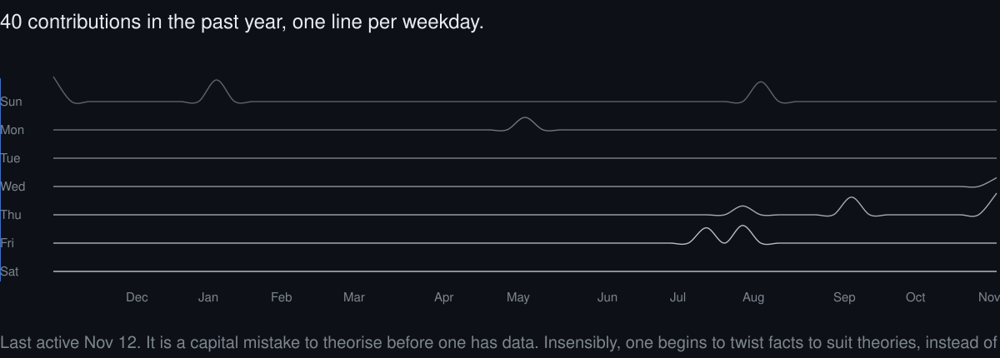

<picture>
  <source media="(prefers-color-scheme: dark)" srcset="./assets/intro-dark.svg">
  <source media="(prefers-color-scheme: light)" srcset="./assets/intro-light.svg">
  
</picture>

 

<picture>
  <source media="(prefers-color-scheme: dark)" srcset="https://skillicons.dev/icons?i=py%2Cdart%2Cflutter%2Ckotlin%2Ccs%2Cdotnet%2Cangular%2Cfirebase%2Cpytorch%2Ctensorflow%2Carduino%2Clinux&theme=dark&perline=12">
  <source media="(prefers-color-scheme: light)" srcset="https://skillicons.dev/icons?i=py%2Cdart%2Cflutter%2Ckotlin%2Ccs%2Cdotnet%2Cangular%2Cfirebase%2Cpytorch%2Ctensorflow%2Carduino%2Clinux&theme=light&perline=12">
  
</picture>

  

**Now:** building Master Deutsch, an AI-powered German learning app in Flutter and Firebase with OpenAI and Gemini behind it. Also a research associate at UCP, working on energy-efficient smart irrigation. 
**Researching:** cyber-physical systems and edge IoT, from ESP32 and STM32 sensor nodes to ML on edge hardware, plus trustworthy AI defenses for tool-using LLM agents. 
**Ask me about:** Flutter and LLM apps, edge IoT and sensing, or ASP.NET Core and Angular.

 

<picture>
  <source media="(prefers-color-scheme: dark)" srcset="./assets/signal-dark.svg">
  <source media="(prefers-color-scheme: light)" srcset="./assets/signal-light.svg">
  
</picture>

 

Find me on [LinkedIn](https://www.linkedin.com/in/1awaistariq/) or by [email](mailto:awaistariq.dev@gmail.com).
